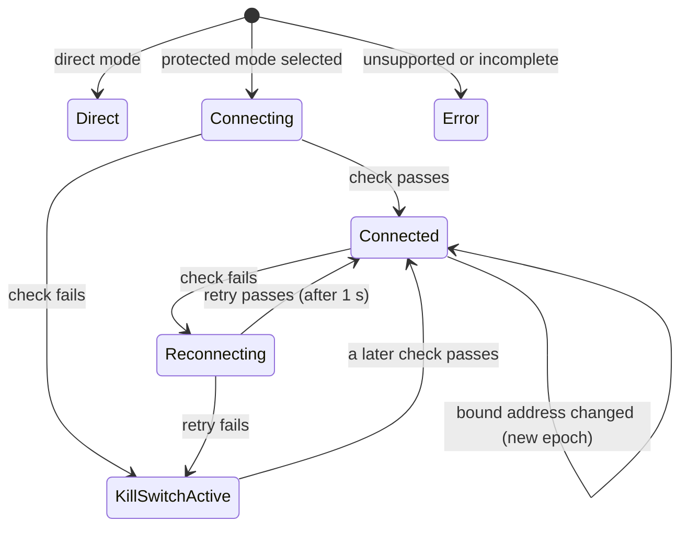
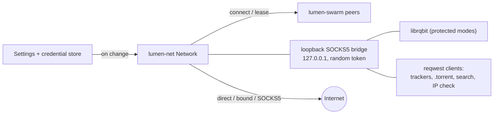

# Network modes and kill switch

> **Status:** direct, VPN adapter binding, SOCKS5, and the built-in WireGuard tunnel work.
> Protected modes keep the kill switch engaged until their connection is verified.
> Code: `crates/lumen-net`.

## The invariant

> If a VPN interface, proxy, or tunnel is selected, **no traffic leaves through any other path.**
> TorrentStream never falls back to a direct connection.

Every outbound connection TorrentStream makes for torrents, trackers, `.torrent` downloads, search, and
the connection check asks `lumen_net::Network` first. In a protected mode (anything but
direct), connections are refused until the mode is verified, and whenever a health check fails.
Existing connections are closed at the same moment. UDP is never sent through a proxy. When bound
to an interface, TorrentStream sends UDP tracker announces itself, from sockets bound to the interface's
address (`Network::udp_socket`), so they leave only through it; librqbit's own UDP (DHT, uTP, its
UDP tracker client) stays off, because librqbit cannot pin UDP sockets to an interface on
Windows. WireGuard tracker datagrams use the application-local tunnel and its DNS servers;
they never use unbound OS UDP.

The webview cannot reach the network itself: its CSP allows only `ipc:` and the loopback stream
server (as media, and with `fetch` for converted audio). The FFmpeg sidecar that converts Dolby
and DTS audio reads only from a loopback server, with proxy variables removed from its
environment.

## Modes

| Mode                        | What happens                                                                                                                                                                                 | Verified by (every 5 s)                                                                                     |
| --------------------------- | -------------------------------------------------------------------------------------------------------------------------------------------------------------------------------------------- | ----------------------------------------------------------------------------------------------------------- |
| **Direct** (default)        | No VPN or proxy. No kill switch.                                                                                                                                                             | Nothing.                                                                                                    |
| **VPN (bind to interface)** | Every TCP connection is pinned to one interface, usually the adapter of the user's own VPN app (WireGuard, OpenVPN, a provider app). See [platform support](#interface-binding-by-platform). | The interface exists, is up, and has a usable (non-loopback, non-link-local) address.                       |
| **SOCKS5 proxy**            | Every TCP connection goes through the proxy (RFC 1928), with optional username and password (RFC 1929). Host names are resolved by the proxy unless "Resolve DNS through the proxy" is off.  | A TCP connection to the proxy plus the method negotiation and login. No connection is requested through it. |
| **WireGuard**               | TCP and DNS run inside an application-local WireGuard tunnel using the imported configuration. No OS routes or adapters are changed.                                                         | A successful authenticated handshake less than 180 seconds old.                                             |

A protected mode with incomplete settings (a proxy without a host, a username whose password is
missing from the credential store, no interface chosen) is also `Error`: blocked, with the reason
shown, until the settings are fixed.

## What each kind of traffic does

| Traffic                                 | Direct                                                          | Bind to interface              | SOCKS5 proxy                                                   | Kill switch engaged   |
| --------------------------------------- | --------------------------------------------------------------- | ------------------------------ | -------------------------------------------------------------- | --------------------- |
| Peers over TCP, lumen-swarm             | direct                                                          | bound to the interface         | through the proxy                                              | refused, closed       |
| Peers over TCP, librqbit (rqbit engine) | direct                                                          | via the loopback bridge, bound | via the loopback bridge, through the proxy                     | refused, closed       |
| Peers over uTP (librqbit)               | when listening                                                  | **off**                        | **off**                                                        | off                   |
| Incoming peer connections               | librqbit only if a listen address is set (it is not by default) | **off**                        | **off**                                                        | off                   |
| HTTP(S) trackers                        | direct                                                          | bound (system DNS)             | through the proxy (proxy DNS for lumen-swarm, see [DNS](#dns)) | refused               |
| UDP trackers                            | direct                                                          | TorrentStream's client, bound  | **skipped**                                                    | through WireGuard     |
| DHT (both engines)                      | on                                                              | **off**                        | **off**                                                        | off                   |
| Local peer discovery (multicast)        | off                                                             | off                            | off                                                            | off                   |
| `.torrent` file downloads               | direct                                                          | bound                          | through the proxy                                              | refused               |
| Search (search.emberglow.tech)          | direct                                                          | bound                          | through the proxy                                              | refused               |
| Public-IP check (icanhazip.com)         | direct                                                          | bound                          | through the proxy                                              | refused, nothing sent |

"Skipped" and "off" mean the traffic is not sent at all, never sent around the mode. When bound to
an interface or using WireGuard, a magnet link's UDP trackers are announced through scoped sockets
(`lumen_swarm::udp_tracker`) and the peers they name are handed to librqbit for the metadata, and
lumen-swarm keeps announcing to them while it streams. Through a proxy, without the DHT and UDP
trackers, magnet links whose only trackers are UDP cannot be opened; TorrentStream says so at once instead
of waiting for the metadata timeout. `.torrent` files still
work through lumen-swarm, and peers learned from HTTP trackers or peer exchange are used.

In SOCKS5 mode, turning off "Send tracker requests through the proxy" turns trackers off
entirely for that mode; trackers are never contacted directly.

## Kill switch and connection state

| State              | Traffic | Meaning                                                              |
| ------------------ | ------- | -------------------------------------------------------------------- |
| `direct`           | allowed | Direct mode.                                                         |
| `connecting`       | blocked | A protected mode was just selected; the first check is running.      |
| `connected`        | allowed | The last check passed.                                               |
| `reconnecting`     | blocked | A check just failed; one quick retry follows.                        |
| `killSwitchActive` | blocked | The mode is not working. Checks continue; traffic resumes by itself. |
| `error`            | blocked | The mode cannot work (incomplete settings or unsupported platform).  |
| `disconnected`     | blocked | The app is closing.                                                  |

A failed connection to the proxy also triggers an immediate check instead of waiting for the next
interval.

**Epochs and leases.** Each change that could leave a connection on the wrong path (a new mode,
the kill switch engaging, the bound interface changing address) starts a new epoch. Every
connection holds a `Lease` for the epoch it was made in and closes when it is revoked:
lumen-swarm peers, and every connection relayed by the loopback bridge (pooled HTTP connections
included). A connection that finishes connecting after the epoch changed is dropped.

**Recovery.** While traffic is blocked, lumen-swarm does not attempt connections, so no peers are
used up. When traffic is allowed again it re-queues every known peer that is not connected and
restarts tracker announces under the new rules. librqbit's peers reconnect through the bridge.

**Events.** Mode changes, connects, losses, and recoveries are logged with timestamps (the last
50 are in `NetworkStatus.events`, never with secrets) and sent to the webview as
`network-status` events.

**In the UI.** The network indicator (bottom bar, and the player's status line) follows these
events: gray `Direct · no VPN`; green `Protected · <proxy or WireGuard endpoint>` or `Bound · <VPN adapter>` when connected;
yellow `Connecting…` or `Reconnecting…`; red `Kill switch: traffic paused (<reason>)` or
`Network error: <reason>`. Its tooltip has the mode, endpoint, uptime (`connectedSinceMs`), and
the latest events; clicking it opens Settings → Network, which shows the same state with a **Try
again** button (`recheck_network`). When the kill switch pauses traffic and the video runs out
of data, the player says "VPN/proxy disconnected — traffic paused" instead of "Buffering…".

## How it is wired

- **lumen-swarm** calls `Network::connect` for every peer and holds the lease.
- **HTTP clients** (`reqwest`) are pointed at the **loopback bridge** with `socks5h://`, so host
  names reach the bridge unresolved. The bridge is a SOCKS5 server on `127.0.0.1` that accepts
  only clients presenting a random per-run token (RFC 1929 password, compared in constant time),
  supports only `CONNECT`, and makes each connection with `Network::connect_host`. The clients
  are never rebuilt: the bridge follows mode changes and closes its connections when the epoch
  changes.
- **librqbit** cannot be pointed at a connector, so in protected modes it gets the bridge as its
  SOCKS5 proxy (`ConnectionOptions::proxy_url`), no DHT, no listening socket (so no uTP or
  incoming connections), and no local discovery. Its magnet links lose their UDP trackers before
  they are added, and `.torrent` files are refused when librqbit is forced as the engine (their
  tracker lists cannot be filtered); with the automatic engine, `.torrent` files go to
  lumen-swarm anyway. These session options are fixed at start, so when protection turns on or
  off `StreamEngine::apply_network` stops the librqbit session first (dropping its torrents),
  then switches; the next magnet link starts a new session.
- **Settings.** The app starts the network manager from the saved settings before anything
  connects, and re-applies them after every settings or secret change
  (`src-tauri/src/network.rs`). There is no separate apply command.

## Interface binding by platform

| Platform       | How a connection is pinned                                                                                                          | Notes                                                                                                                                                                           |
| -------------- | ----------------------------------------------------------------------------------------------------------------------------------- | ------------------------------------------------------------------------------------------------------------------------------------------------------------------------------- |
| Windows        | Bind the socket to the interface's address. Windows uses the strong host model: such packets can leave only through that interface. | Interface names are adapter friendly names ("Wi-Fi", "WireGuard Tunnel", "ProtonVPN"). If the adapter has no route for a destination, the connection fails rather than leaking. |
| Linux, Android | `SO_BINDTODEVICE`, plus the address.                                                                                                | Needs Linux 5.7+ or `CAP_NET_RAW`; without it the mode is `Error`, never unbound.                                                                                               |
| macOS, iOS     | `IP_BOUND_IF` / `IPV6_BOUND_IF` by interface index, plus the address.                                                               |                                                                                                                                                                                 |
| Others         | Not supported: the mode is `Error`.                                                                                                 |                                                                                                                                                                                 |

All of this goes through `socket2` and Tokio; no `unsafe` code. Interfaces are listed with
`if-addrs` (MIT OR BSD-3-Clause).

## DNS

| Mode              | Who resolves host names                                                                                                                                                                                                                                                                                          |
| ----------------- | ---------------------------------------------------------------------------------------------------------------------------------------------------------------------------------------------------------------------------------------------------------------------------------------------------------------- |
| Direct            | The system resolver.                                                                                                                                                                                                                                                                                             |
| Bind to interface | The system resolver. Where the query goes depends on the VPN app's DNS settings; TorrentStream cannot pin it to the interface. **Not verified by TorrentStream.**                                                                                                                                                |
| SOCKS5            | The proxy, for lumen-swarm trackers, `.torrent` downloads, search, and the connection check (no DNS query leaves the machine). **Exception:** librqbit resolves its HTTP tracker names with the system resolver before using the proxy (it only speaks `socks5://`); the announce itself goes through the proxy. |

| WireGuard | The configured DNS servers, contacted through the WireGuard tunnel. The system resolver is used only to bootstrap the VPN server endpoint. Missing DNS blocks TorrentStream-controlled host-name lookups without a direct fallback. As in SOCKS5 mode, librqbit resolves its HTTP tracker names with the system resolver before using the bridge. |

## IPv6

In protected modes IPv6 destinations are refused unless "IPv6 through the tunnel" is chosen, so
IPv6 cannot bypass a VPN or proxy that only carries IPv4. In SOCKS5 mode with proxy DNS, the
proxy decides which address family it uses.

## WireGuard

`lumen_net::WireGuardConfig::parse` reads `wg-quick` files strictly: `[Interface]` with
`PrivateKey` (base64, 32 bytes, not all zero), at least one `Address` (CIDR), optional `DNS`,
`MTU`, `ListenPort`; one or more `[Peer]` with `PublicKey`, optional `PresharedKey`, at least one
`AllowedIPs` range, an `Endpoint` (`host:port`, IPv6 in brackets), and optional
`PersistentKeepalive`. Keys are case-insensitive, comments start with `#`, files over 64 KiB are
refused. Script hooks (`PreUp`, `PostUp`, `PreDown`, `PostDown`) are reported as ignored and are
never run. Errors name the line but never repeat key material.

The summary returned to the UI (`validate_wireguard_config`) has addresses, DNS, endpoints,
public keys, allowed ranges, and whether a preshared key exists, never the private or preshared
key. The Settings page shows it first; **Save configuration** then calls
`import_wireguard_config`, which parses the file again in Rust, stores the private key (and
preshared key, if any) in the OS credential store, and saves the rest in `network.wireguard`.
The keys never travel back to the webview, and only one `[Peer]` is accepted.

### Connecting inside TorrentStream

Choose **WireGuard** in Settings → Network & VPN, then import or paste the provider's `.conf`
file. Saving an imported configuration while this mode is selected starts the tunnel. **Connect**
checks it again immediately; selecting another mode closes the old tunnel and its connections.
The private key and optional preshared key are read from the OS credential store only in Rust.
Missing or invalid keys block traffic with an error. A successful authenticated handshake is
required before any application traffic is allowed. Handshakes older than 180 seconds engage
the kill switch; keepalives keep the peer active and later successful handshakes resume traffic.

The tunnel uses boringtun and smoltcp through a locally maintained copy of tokio-wireguard.
It carries only TorrentStream's traffic and needs no administrator rights, TUN driver, system VPN app,
or changes to Windows routes. TCP connections are relayed through private, source-checked
loopback socket pairs so existing HTTP, search, peer, and lease handling applies unchanged.
All traffic remains inside the tunnel; there is no direct fallback.

Exactly one peer and one IPv4 and/or one IPv6 tunnel address are supported. `AllowedIPs`
controls destinations routed to the peer. Host names require an IP address in `DNS`; queries
from TorrentStream's network connector are sent to that server inside the tunnel. The VPN server's
endpoint host name is resolved by the system during tunnel setup. **DNS limitation:** librqbit
still resolves its HTTP tracker names through the system resolver, as it does in SOCKS5 mode;
this affects magnet metadata lookup. TorrentStream-swarm and search use tunneled DNS. IPv6 application destinations
still require **IPv6 → Route through the tunnel** and an IPv6 tunnel address.
UDP tracker announces and tracker DNS now run inside WireGuard. Their peers bootstrap magnet
metadata fetching and remain available to the streaming engine. DHT, incoming peers, and uTP
remain disabled in built-in WireGuard mode. Successful tracker replies are retained when other
trackers time out.

### Using a VPN app

Choose **VPN**, connect your VPN app, then select its tunnel adapter and press **Refresh** if
necessary. This works with existing OpenVPN, WireGuard, and provider-app connections; it does
not import `.ovpn` files or start those apps. VPN adapters appear first in the picker.
The `bindInterface` setting remains compatible with existing saved profiles.

Hyper-V's **Default Switch** and **WSL** adapters are local virtual networks, not VPN tunnels;
they normally have no internet route for connections bound on the Windows host. The settings
show a warning when one is selected. Tailscale needs an exit node to carry internet traffic.
An adapter showing **Bound** only means TorrentStream pinned traffic to it; it does not establish VPN
encryption or prove that the adapter can reach the internet. Use **Check connection** to verify
that requests work through the selected path.

## Connection check

The public-IP check (`Network::check_public_ip`) sends two HTTPS requests at once,
`GET https://ipv4.icanhazip.com/` and `GET https://ipv6.icanhazip.com/`, through the current
mode (via the bridge), and returns the IPv4 and IPv6 addresses the service saw; either may be
missing (no IPv6, or a VPN that carries only IPv4, or IPv6 disabled in protected modes). If the
kill switch is engaged it fails without sending anything. icanhazip sees each request's source
address (your VPN's or proxy's address in a protected mode) and nothing else: the requests carry
no user agent or other identifiers. Each answer is limited to 1 KiB and must be a plain address
of the right family (`{"ip": "<address>"}` is accepted too).

It runs:

- in the status bar (`network.showPublicIp`, on by default): at start-up, whenever traffic is
  allowed again or the mode or connection epoch changes, and every 10 minutes, at most once
  every 5 seconds (`watch_public_ip` in `src-tauri/src/network.rs`). While traffic is blocked
  or the setting is off the address is forgotten, so a stale one is never shown as current.
- when the user clicks **Check connection** (`check_connection`), whatever the setting.

## Settings mapping

The Settings page (`lumen-settings`) stores what the user chooses; the app turns it into a
`lumen_net::NetworkConfig`:

| Setting                        | Effect                                                                                                    |
| ------------------------------ | --------------------------------------------------------------------------------------------------------- |
| `network.mode`                 | The mode.                                                                                                 |
| `network.interface`            | Interface for binding.                                                                                    |
| `network.socks5.host`, `port`  | The proxy.                                                                                                |
| `network.socks5.username`      | With the `socks5Password` secret from the credential store. A username without a password blocks traffic. |
| `network.socks5.proxyDns`      | Proxy resolves host names (`socks5h`). Off: resolved locally, only addresses are sent.                    |
| `network.socks5.proxyTrackers` | Off: trackers are not contacted in this mode.                                                             |
| `network.socks5.proxyDht`      | No effect yet: the DHT is off in every protected mode (no UDP ASSOCIATE support). Shown as read-only.     |
| `network.wireguard`            | Shown in the status (endpoint). The private key is not read until the tunnel exists.                      |
| `network.ipv6`                 | `tunnel` allows IPv6 destinations in protected modes; `disable` refuses them.                             |
| `network.encryption`           | Not implemented by either engine yet.                                                                     |

## Limits

- No DHT or uTP in protected modes, and no UDP at all through a proxy, so fewer peers. Planned:
  SOCKS5 UDP ASSOCIATE, and a DHT on bound sockets.
- Bound-interface DNS goes to the system resolver (see [DNS](#dns)).
- librqbit resolves tracker host names locally in SOCKS5 mode.
- The bound-interface check proves the adapter is up with an address, not that it reaches the
  internet; the public-IP check (status bar, or "Check connection") does.
- Switching protection on or off stops librqbit's torrents (only those using the `rqbit`
  engine choice); they must be added again. lumen-swarm torrents, magnet links included,
  continue.

## Tests

All on loopback, no internet:

- WireGuard peer integration tests authenticate with preshared keys, transfer TCP data, resolve
  a search hostname through tunneled UDP DNS, check a public-IP response through the tunnel,
  reject incorrect keys, and close connections on mode changes.

- `crates/lumen-net`: SOCKS5 client and server parsers (malformed replies, auth, IPv6, domain
  targets), WireGuard parser, and end-to-end tests with a recording SOCKS5 proxy: proxied
  connections, remote DNS through the bridge, the kill switch blocking connections, HTTP, and the
  connection check while the proxy is down and recovering after, leases revoked on mode changes,
  incomplete settings blocking, missing interfaces, IPv6 refusal, and the bridge refusing clients
  without the token.
- `crates/lumen-swarm/tests/network.rs`: a lumen-swarm download from a librqbit seeder behind a
  recording relay, through the proxy only (every connection the seeder saw came from the proxy);
  stopping the proxy stops the transfer with no direct connection; restarting it finishes the
  download. HTTP trackers go through the proxy with their names resolved by it; UDP trackers get
  no packets (with a direct-mode control that does see them).
- `crates/lumen-torrent/tests/network.rs`: a magnet link through librqbit in SOCKS5 mode reaches
  the seeder and the HTTP tracker only through the proxy and never the UDP tracker; switching
  from direct to protected replaces the librqbit session.
